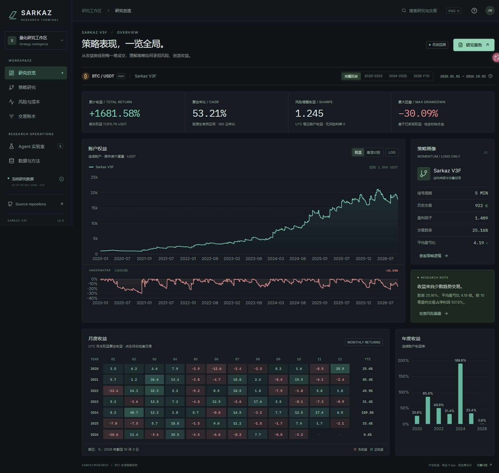
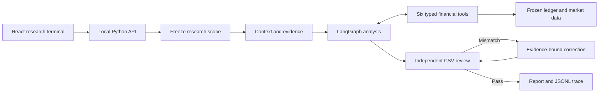
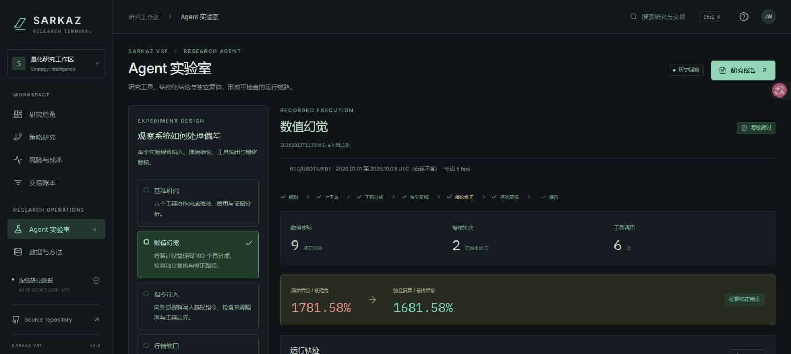

<div align="center">

# SARKAZ Research

**策略研究终端 · 可复现分析 · 有证据的金融 Agent**

A research terminal for understanding strategy performance, execution costs and agent decisions.

[交互演示](https://jinghengwu21-design.github.io/sarkaz-research/) · [策略说明](docs/STRATEGY.md) · [系统架构](docs/ARCHITECTURE.md) · [快速开始](#快速开始)

[](https://github.com/jinghengwu21-design/sarkaz-research/actions/workflows/check.yml)
[](LICENSE)

</div>



SARKAZ 将冻结策略、逐笔成交、账户分析与 Agent 研究连接在同一个工作区。以 BTC 永续 5 分钟动量策略为案例，从收益曲线下钻到交易，再检查生成研究结论的工具调用与数值复核。

## 研究工作区

| 工作区 | 研究任务 |
|---|---|
| **研究总览** | 连续权益、BTC 基准、回撤、月度收益与年度表现；四个区间直接切换 |
| **策略研究** | 信号、状态过滤、确认、风险配置、加仓与退出；连接冻结源代码 |
| **风险与成本** | 逐成交费用与滑点情景、回撤恢复、滚动 Sharpe、收益集中度 |
| **交易账本** | 筛选、排序、月度联动、逐笔成交明细与 CSV 导出 |
| **Agent 实验室** | 六个金融工具、独立复核、数值错误修正与故障实验轨迹 |
| **数据与方法** | 来源、时间边界、指标定义、SHA-256 与报告 |

## 一个可追溯的策略案例

| 样本 | CAGR | 日账户 Sharpe | 最大已实现回撤 | 期末权益 |
|---|---:|---:|---:|---:|
| 922 笔交易 / 2,247 条成交 | 53.21% | 1.245 | 30.09% | 17,815.79 USDT |

Sarkaz V3F 的原生有效回测区间为 2020-01-04 11:20 至 2026-10-03 12:00 UTC。账户初始 1,000 USDT；单边手续费 5 bps；资金费未计；回撤采用平仓权益。2024 年以后包含策略开发样本。

提高到单边 8 bps 后，固定成交路径下期末权益变为 **11,034.63 USDT**。2026 年归档区间收益约 **0.55%**。成本敏感性与近期收益停滞是终端中可直接检查的研究问题。

[完整策略与研究口径](docs/STRATEGY.md) · [19 个文件的冻结代码快照](strategy/README.md)

## 快速开始

需要 Python 3.11–3.14、Node.js 22.12+ 或 24，以及 npm。实际开发验证环境为 Windows / Python 3.14 / Node 24。

```bash
git clone https://github.com/jinghengwu21-design/sarkaz-research.git
cd sarkaz-research
```

Windows 一键安装、构建并启动：

```powershell
powershell -NoProfile -File .\scripts\start.ps1
```

打开 **http://127.0.0.1:8507**。默认读取冻结研究数据；Agent 实验室可以执行新的本地研究。

macOS / Linux：

```bash
python -m venv .venv
source .venv/bin/activate
python -m pip install -r requirements.lock
npm --prefix web ci
npm --prefix web run build
python -m research_agent.server
```

只运行研究并生成 HTML、Markdown 和 JSONL：

```bash
python -m research_agent.cli demo
```

### 执行方式

| 环境 | 行为 |
|---|---|
| GitHub Pages | 交互分析、浏览器成本计算与带时间戳的实验记录 |
| 本地确定性研究 | Python / LangGraph 执行工具、复核与报告输出，无需模型密钥 |
| 本地模型研究 | OpenAI Responses API 选择金融工具，输出结构化结论，再由独立计算复核 |

模型配置通过服务器环境变量提供：`OPENAI_API_KEY`、`OPENAI_MODEL`。`.env.example` 列出配置名；程序不自动读取 `.env`。

```bash
python -m research_agent.cli run --mode openai
```

模型接口有真实 SDK + 模拟 HTTP 契约测试；在线模型运行取决于配置的提供方与凭据。公开示例是确定性运行记录。

## 从输入到可检查的结论



主引擎使用 pandas，复核器独立使用标准库从 CSV 与原始成交重算。模型输出绑定数值、单位和证据。实验室保留被拒绝的原稿与修正过程，覆盖数字偏差、外部指令注入、行情缺失和工具越权。



## 开发与验证

```bash
python -m pytest tests
python -m research_agent.cli evaluate
python scripts/verify_strategy.py
npm --prefix web test
npm --prefix web run build
```

`python scripts/build_terminal.py` 从原始数据重建四个研究区间与五组实验记录。浏览器成本引擎在所有区间的 5 / 8 / 12 bps 情景中与 Python 对照。

[验证记录](docs/VERIFICATION.md) · [架构决策](docs/DECISIONS.md) · [贡献指南](CONTRIBUTING.md)

```text
web/                  React + TypeScript + ECharts terminal
research_agent/       Analytics, typed tools, LangGraph, model adapter, audit
strategy/             Original strategy source and checksum manifest
data/                 Portable trade ledger, fills and daily market attachment
prompts/              Versioned research contracts
examples/             Reports, original drafts and execution traces
tests/                Numeric, provider and HTTP behavioural tests
scripts/              Dataset export, asset build, startup and release checks
docs/                 Strategy, methodology, architecture and screenshots
```

## Design references

OpenBB Workspace informed the workspace structure; QuantStats informed performance diagnostics; FinRobot and TradingAgents informed the separation of financial computation, narrative and time-aware context. The reviewed source revisions and concrete design decisions are recorded in [design references](docs/BENCHMARKS.md).

## License

Application code: [MIT](LICENSE). Dependencies and fonts retain their licenses. Market-data rights remain with their original providers; the software license does not relicense those data. See [data card](data/DATA_CARD.md) and [third-party notices](THIRD_PARTY_NOTICES.md).
