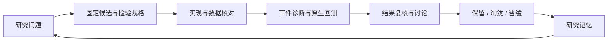

# Agent 在策略研究中的作用

RCM 的历史研究由研究者确定目标、质疑假设并裁决方向，Agent 负责检索资料、实现候选、执行回测、比较结果和维护上下文。循环的产出是一项可以继续、保留或关闭的研究判断。



## 分工与讨论

研究者反复提出的实质问题包括：Signal K 能否仅作为观察提示；下一收盘的代价是否值得；为什么为了有限改善删去大量交易；新增条件是否重复旧信息；分类器是否只在复刻规则；收益增加有多少来自更高风险；失败之后是否还值得增加阈值。这些讨论改变了实验规格和研究方向。

| 工作 | 实施方式 | 留下的产物 |
|---|---|---|
| 资料与候选 | 检索策略、论文和原项目记录，转成可计算机制 | 方法笔记、候选规格、研究问题 |
| 因子实现 | 统一特征接口、时间可用性、缺失与增量状态 | 因子定义、对齐检查、数据附件 |
| 批量实验 | 固定候选、统一费用与样本，再分时间块比较 | 事件表、原生结果、交易差异 |
| 反证与复核 | 消融、集合重叠、成本、极端赢家移除、bootstrap | 拒绝原因与剩余解释 |
| 执行诊断 | 区分候选、持仓阻挡、委托、成交和重报价 | 漏单与生命周期分析 |
| 上下文维护 | 把假设、实验、结论与下一步问题登记 | 因子库、实验账本、关闭路线 |

研究中出现过监督学习、滚动状态模型、事件检验与原生策略回测。它们属于不同工具和实验阶段；保留策略的规则由最终继承链决定。

## 四轮具有代表性的循环

### 1. TFI：从新数据回到信息增量

候选问题是主动买方参与能否替代成交量异常。规格固定为同根 `TFI > 0` 替代 `volume z > 4`，预先约定样本量、时间块、月簇 bootstrap 与极端值检验。

Agent 构建 Binance 47 个月的 411,840 根 5m 网格，先核对全市场分布。全市场有效 K 中正值占 49.30%，说明符号没有整体偏置；在固定上涨 Signal K、Regime、结构与重复抑制后的条件样本中，2,306 / 2,314 个可用事件为正值。原异常量参考的 641 个事件中有 639 个同样为正值。

这轮讨论把结果解释为条件冗余：强阳线已经包含方向性主动买入信息，异常量则度量参与规模。八项固定检查只有四项通过，候选在事件阶段关闭；数据管线得到保留。[R41](../research/notes/R41.md)

### 2. 盈利加仓：从收益提升拆到账户路径

候选针对趋势已展开后增加暴露。实现包括 +1R 已完成收盘、单次约 25% 加仓、首仓资本预留和原入场价保本。原生对照保持 365 笔与全部平仓时刻，收益从 141.31% 提升到 169.20%。

进一步拆分后，161 笔加仓交易贡献 +457.14 USDT 差额，204 笔未加仓交易贡献 −178.27 USDT。讨论因此保留了成组规则和复利解释。随后测试 HighAdd50、二次信号加仓和 Reserve，发现历史风险代价，最终停在单次加仓。[R14](../research/notes/R14.md)、[R17](../research/notes/R17.md)、[R18](../research/notes/R18.md)

### 3. 状态模型：从高一致率回到交易问题

第一阶段让 XGBoost 学习 Regime V2 规则教师，留出段 accuracy 约 94.63%、macro-F1 约 94.86%。当模型标签用于替代过滤时，交易与收益下降。研究者质疑“高准确率”的含义，后续转向 GMM 潜在标签和 XGBoost 概率拟合。

滚动版本按过去 180 日训练、随后 7 日推断，形成 131 折与 262,692 行输出，并实现 GPU、PIT 特征和在线／离线接口。状态语义漂移、频繁切换和置信度校准继续影响交易用途，最终策略保留 Regime V2。[R23](../research/notes/R23.md)、[R24](../research/notes/R24.md)

### 4. 删除状态：让额外机会接受共同账户检验

研究先删除整个入场 context，保留其他交易管理，比较同一训练窗口。交易从 499 增至 566，收益从 341.71% 提高到 364.65%，但 PF 从 1.412 降至 1.290，回撤从 30.02% 增至 32.83%，只有三个半年度改善。

这个结果把后续目标从“增加交易”改为“在覆盖与时间稳定性下寻找新信息”。路径效率、Jump Model、OBV 等替代因此沿用覆盖与分块比较，未替代原始状态。[R26](../research/notes/R26.md)、[R29](../research/notes/R29.md)、[R33](../research/notes/R33.md)、[R42](../research/notes/R42.md)

## 研究记忆如何减少重复

2026-10-03 快照中的因子库登记 34 个定义：5 个活动、8 个诊断、20 个拒绝、1 个提议；另一层假设／实验账本登记 25 个假设与 38 项实验。这些是各登记表的当时状态，覆盖范围不等同于整个项目历史。

本仓库用 `research/chronicle.json` 把开发史整理为 48 个主题节点。每项记录问题、方法、证据、裁决、认识与原始报告路径；`build_research.py` 生成笔记、CSV 和网站档案。回查一次被关闭的路线时，可以先理解原来的失败机制，再判断新数据或新问题是否足以支持重启。

## 可运行的分析 Agent

历史策略循环之外，本仓库提供一个可本地执行的 LangGraph 分析服务。它读取归档交易账本，运行绩效与成本研究，输出结构化结论，再独立复核数值。

```text
plan → context → analysis → review → export
                               ↓        ↑
                             repair → review
```

`ToolRunner` 注册六个工具；`workflow.py` 管理状态转换；`audit.py` 用独立 CSV 算法复算；`reporting.py` 生成 HTML、Markdown、JSON 与 JSONL。前端显示时间戳、工具输入输出、原始结论和修正后的结论。

| 场景 | 注入方式 | 可观察行为 |
|---|---|---|
| 基准 | 正常研究输入 | 完成工具分析和复核 |
| 数值偏差 | 草稿累计收益增加 100pp | 独立复核拒绝，保留原草稿，修正后复核 |
| 指令注入 | 外部文字包含越权指令 | 记录来源隔离结果，计算继续来自账本 |
| 行情缺口 | 移除一个完整 UTC 日 | 报告缺失日，不插值掩盖 |
| 工具越权 | 请求 `execute_shell` | 未注册调用被拒绝，轨迹记录拒绝理由 |

模型模式使用 Responses function calling 和结构化 Draft，限制调用轮数；公开演示是确定性运行，接口测试使用真实 SDK 和模拟 HTTP 响应。五类实验检验指定故障下的工程行为，衡量对象不是模型总体幻觉率。

[运行命令](../README.md#分析-agent) · [系统架构](ARCHITECTURE.md) · [工程案例](ENGINEERING.md)
